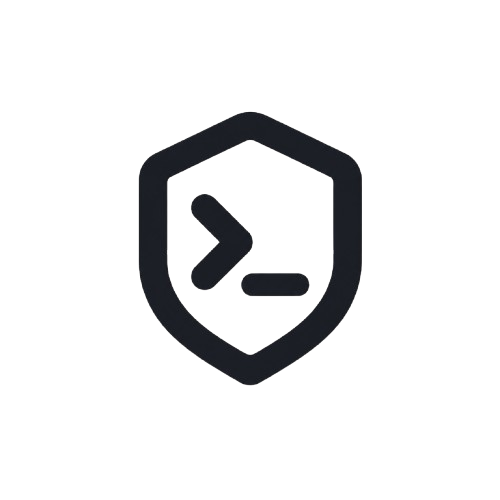

<div align="center">



# Grudge

### Deterministic regression scars for AI agents
every failed agent trace is automatically turned into a regression test, so your agent never makes the same mistake twice.

<p>
  <a href="https://www.npmjs.com/package/grudge-cli"></a>
  <a href="https://pypi.org/project/grudge-cli/"></a>
  <a href="https://github.com/harshithKumar12/Grudge/blob/master/LICENSE"></a>
  <a href="https://nodejs.org/"></a>
  <a href="https://www.python.org/"></a>
</p>

<p>
  <a href="#quick-start">Quick start</a> ·
  <a href="#how-it-works">How it works</a> ·
  <a href="#cli-reference">CLI reference</a> ·
  <a href="#development">Development</a>
</p>

</div>

> **Release status:** source version `0.1.8` is being prepared. Verify the
> package registries and complete the release checklist before publishing.

## Table of contents

- [Overview](#overview)
- [Why Grudge](#why-grudge)
- [Features](#features)
- [How it works](#how-it-works)
- [Architecture](#architecture)
- [Quick start](#quick-start)
- [Install the packages](#install-the-packages)
- [Docker](#docker)
- [CLI reference](#cli-reference)
- [Integrations](#integrations)
- [Project structure](#project-structure)
- [Configuration and data](#configuration-and-data)
- [Testing](#testing)
- [Troubleshooting](#troubleshooting)
- [Development](#development)
- [Release checklist](#release-checklist)
- [Security and privacy](#security-and-privacy)
- [Roadmap](#roadmap)
- [Benchmark status](#benchmark-status)
- [Limits](#limits)
- [Contributing](#contributing)
- [License](#license)

## Overview

AI agents can repeat the same unsafe or incorrect action after a prompt change,
tool-result change, or model change. A transcript can show the failure, but it
does not provide a compact regression test that can be replayed against the
live policy.

Grudge turns the failure into a **Scar**:

1. Capture the agent's typed trace.
2. Freeze only the external world in a replay cassette.
3. Shrink the cassette to the smallest causal example.
4. Describe the failure with a readable deterministic predicate.
5. Prove that the bad behavior is red and the fixed behavior is green.
6. Run the Scar again in CI or enforce it locally before a tool executes.

The core workflow is local-first, deterministic, and designed to work without
provider credentials or network access.

## Why Grudge

| Problem | Grudge's answer |
|---|---|
| Long transcripts are difficult to review | Store a compact cassette and predicate |
| Replaying a transcript can hide policy changes | Replay the world while keeping the policy live |
| Generated rules can be vague | Compile and evaluate deterministic DSL predicates |
| A one-off test is easy to over-trust | Require red/green admission evidence and benign controls |
| Agents can repeat a known mistake locally | Install a lightweight Node Guard with Claude Code hooks |
| Tool output may contain secrets | Redact captured content before persistence |

## Features

### Python engine

- Typed trace capture and schema validation.
- Secret-aware redaction for recorded traces.
- Strict cassette replay with ordered, single-use entries.
- Delta debugging and content reducers for shrinking failures.
- Deterministic predicates for call shape, ordering, and MVP taint flow.
- Scar admission with bad-agent, fixed-agent, and benign-control evidence.
- Wilson-bound statistical gating for repeated checks.
- Offline demo, JSON output, Markdown/Rich reports, and a local event viewer.

### Node Guard

- Interactive setup for repository, user, or all-project scopes.
- Claude Code hook registration for `SessionStart`, `UserPromptSubmit`,
  `PreToolUse`, `PostToolUse`, and `Stop`.
- Deterministic blocking of admitted mistakes before a tool runs.
- Duplicate hook accounting protection across overlapping scopes.
- Status-line reporting with estimated savings.
- `doctor` diagnostics, dry-run setup, timestamped backups, and safe uninstall.
- Selective cleanup that preserves user content and third-party hooks/status
  lines.
- Self-contained bundled runtime with no npm runtime dependencies.

### Documentation and operations

- Architecture, trust-model, integration, hook, and token-budget docs.
- Local package smoke tests for npm and Python artifacts.
- Release metadata consistency checks.
- No telemetry, hosted service, MCP server, or runtime network requirement.

## How it works

```text
agent run
    │
    ▼
typed trace ──► cassette ──► shrinker ──► minimal causal world
    │                                      │
    │                                      ▼
    └──────────────────────────────► predicate and Scar
                                           │
                                           ▼
                              admission proof and CI gate
                                           │
                                           ▼
                              local Guard enforcement
```

### The three Scar artifacts

1. **Cassette** — the frozen external world. Replay serves only matching,
   single-use responses; the policy still computes its next action.
2. **Predicate** — the readable never-again rule. It describes the call shape,
   ordering, or taint flow that identifies the failure.
3. **Verdict** — the evidence that the rule discriminates correctly: red on the
   vulnerable path, green on the fixed path, and nonempty benign controls.

## Architecture


The engine is CLI-first. The recorder emits typed events, replay freezes only
the external world, the shrinker minimizes the cassette, deterministic code
evaluates predicates, admission proves the Scar, and the gate turns repeated
clean runs into a decision.

The local viewer consumes demo events over a local SSE server. It does not own
pipeline state or verdict logic.

For the detailed contracts, see:

- [`docs/architecture.md`](docs/architecture.md)
- [`docs/trust-model.md`](docs/trust-model.md)
- [`docs/cassette-format.md`](docs/cassette-format.md)
- [`docs/predicate-dsl.md`](docs/predicate-dsl.md)
- [`docs/statistics.md`](docs/statistics.md)

## Quick start

### 1. Install the local Node Guard

From any repository where you want local protection:

```bash
npx grudge-cli@latest setup
npx grudge-cli@latest doctor
```

`npx` runs the package temporarily; it does **not** create a permanent
`grudge` command in PowerShell. To use the Node Guard directly as `grudge`,
install the package globally:

```powershell
npm install --global grudge-cli
Get-Command grudge
grudge --version
grudge doctor
```

For this checkout, install the local build instead of the registry package:

```powershell
npm --prefix packages/grudge run build
npm install --global .\packages\grudge
grudge --version
```

If PowerShell still says that `grudge` is not recognized, add npm's global
binary directory to your user PATH, open a new PowerShell window, and retry:

```powershell
$npmBin = npm prefix --global
$userPath = [Environment]::GetEnvironmentVariable("Path", "User")
if (($userPath -split ';') -notcontains $npmBin) {
  [Environment]::SetEnvironmentVariable("Path", "$userPath;$npmBin", "User")
}
$env:Path = "$npmBin;$env:Path"
grudge --version
```

If both packages are installed, use the explicit aliases to avoid ambiguity:

```powershell
grudge-node doctor       # npm Node Guard
grudge-engine --help     # Python engine
```

Every command also has a short form, so the common setup can be written
`grudge setup -y -a claude-code -s repo` instead of
`grudge setup --yes --agents claude-code --scope repo`, and
`grudge-engine run -s scars -a examples.leaky_agent.agent_fixed -j` instead of
`grudge-engine run --scars scars --agent examples.leaky_agent.agent_fixed --json`.
Long forms always work too; `grudge --help` and `grudge-engine --help` list both.

For a non-interactive Claude Code repository setup:

```bash
npx grudge-cli@latest setup --yes --agents claude-code --scope repo
npx grudge-cli@latest doctor
```

Preview changes without writing files:

```bash
npx grudge-cli@latest setup --dry-run
```

Remove only Grudge-managed content:

```bash
npx grudge-cli@latest uninstall
```

### 2. Install the Python engine

```bash
python -m pip install grudge-cli
grudge-engine --help
```

The Python package also provides `grudge`, but the npm Node Guard and Python
engine intentionally share that short name for compatibility. When both are
installed, prefer `grudge-node` and `grudge-engine`.

For a checkout-based development install:

```bash
python -m pip install -e .
```

### 3. Run the offline demo

```bash
grudge-engine demo --no-browser --fast --json
```

To run the two-session Claude-style hook proof:

```bash
grudge-engine demo --guard --json
```

The demo uses checked-in fake tools and scripted policies. It does not call a
model provider or require public-network access.

## Install the packages

Grudge has two complementary packages with the same user-facing command name:

| Package | Install command | Main responsibility |
|---|---|---|
| `grudge-cli` on PyPI | `python -m pip install grudge-cli` | Full trace, replay, shrinking, admission, gates, and demo |
| `grudge-cli` on npm | `npx grudge-cli setup` | Local Node Guard, hooks, setup, doctor, and uninstall |

### Exercise the npm package from this checkout

From the repository root:

```bash
npm --prefix packages/grudge run build
npm --prefix packages/grudge run setup:repo
npm --prefix packages/grudge run doctor:repo
```

From `packages/grudge` itself:

```bash
npm run build
npm run setup:repo
npm run doctor:repo
npm run uninstall:repo
```

Do not combine `cd packages/grudge` with the root-relative path
`packages/grudge/dist/grudge.mjs`; use `node dist/grudge.mjs` from that
directory or `node packages/grudge/dist/grudge.mjs` from the repository root.

## Docker

The project is local-first and does not require Docker for normal use. Docker
is useful for a clean Linux smoke environment or CI job.

Example development container:

```dockerfile
FROM python:3.14-slim

WORKDIR /workspace
COPY . .

RUN python -m pip install --upgrade pip \
    && python -m pip install -e .

CMD ["python", "-m", "grudge", "demo", "--no-browser", "--fast", "--json"]
```

Build and run it from the repository root:

```bash
docker run --rm grudge-demo
```

The Docker path is intended for headless Python validation. The Node Guard
requires access to the agent configuration files it is installing into, so use
the host environment when testing Claude Code hook behavior.

## CLI reference

Run `grudge-engine --help` or append `--help` to any Python command. Implemented Python
commands include:

```text
grudge-engine capture AGENT_MODULE --out PATH
grudge-engine shrink TRACE --failure RULE --out PATH
grudge-engine admit CASSETTE --bad AGENT_MODULE --good AGENT_MODULE --out PATH
grudge-engine run --scars PATH --agent AGENT_MODULE
grudge-engine demo [--guard] [--no-browser] [--fast] [--json]
grudge-engine scars list [--scars PATH]
grudge-engine scars show SCAR [--scars PATH]
```

The Node Guard runtime provides:

```text
grudge setup [--yes] [--dry-run] [--scope repo|global|all] [--agents LIST]
grudge doctor
grudge uninstall [--json]
grudge hook SessionStart|UserPromptSubmit|PreToolUse|PostToolUse|Stop
grudge propose --rule RULE --why EXPLANATION [--preventive]
grudge accept SCAR_ID
grudge scars list|show
grudge stats
grudge report
grudge statusline
```

Expected input and engine failures use exit code `2`. A passing gate returns
`0`; a blocked gate returns `1`.

By default, commands print structured human-readable ASCII output with grouped
checks, status marks, a summary, and a suggested next command. Use `--json`
for stable machine-readable output and `--debug` when a stack trace is needed;
`--ascii` and `NO_COLOR=1` are accepted and change nothing because output
never emits ANSI color. Claude Code hook stdout remains machine-readable JSON
because the host consumes it directly. See
[`docs/cli-output.md`](docs/cli-output.md) for the complete command matrix.

## Integrations

| Integration | Tier | Notes |
|---|---|---|
| Claude Code | **Guard** | Verified hook enforcement and scope-aware `CLAUDE.md` instructions |
| Codex | Advisory | Instruction-file integration; enforcement is not guaranteed |
| Gemini CLI | Advisory | Instruction-file integration; enforcement is not guaranteed |
| GitHub Copilot | Advisory | Instruction-file integration; enforcement is not guaranteed |
| OpenCode | Advisory | Instruction-file integration; enforcement is not guaranteed |
| Windsurf | Advisory | Instruction-file integration; enforcement is not guaranteed |
| Cursor | Unverified | The installer writes no Cursor files |

See the full [integration matrix](docs/integrations.md) and
[hook contract](docs/hooks.md).

## Project structure

```text
grudge/
├── grudge/                 # Python engine
├── examples/               # Vulnerable and fixed demo agents
├── packages/grudge/        # Node Guard package and bundled runtime
├── tests/                  # Python tests
├── packages/grudge/test/   # Node tests
├── docs/                   # Architecture, contracts, and guides
├── scripts/                # Documentation and release checks
├── pyproject.toml          # Python package metadata
├── Makefile                # Reproducible development commands
└── CHANGELOG.md            # Release history
```

## Configuration and data

Grudge stores local runtime state in `.grudge/` when the Node Guard is enabled.
This includes compiled rules, pending proposals, scars, session events, stats,
and timestamped setup backups.

The installer may update:

- `.claude/settings.json` or `.claude/settings.local.json`;
- scope-matching `CLAUDE.md` instruction files;
- `.gitignore` entries for local Grudge state.

Setup is designed to preserve unrelated user content and third-party hooks or
status lines. Inspect a plan first with `--dry-run`; use `doctor` after setup.

## Testing

Run the primary checks from the repository root:

```bash
npm test --prefix packages/grudge
python -m pytest -q
ruff check .
mypy .
python -m scripts.docs_check
python -m scripts.release_check
git diff --check
```

Build package artifacts without publishing:

```bash
npm pack --prefix packages/grudge
python -m build --outdir release-dist
python -m twine check release-dist/*
```

The repository's focused checks are the recommended release gate. Whole-tree
`ruff check .` and `mypy .` pass today, so a finding in either command is a real
regression rather than expected noise.

The three-OS CI matrix (`.github/workflows/grudge-guard.yml`) runs the Node and
Python suites plus `npm pack --dry-run` on Ubuntu, macOS, and Windows for Python
3.11 and 3.14.

## Troubleshooting

### npm warns about `allow-scripts`

You may see:

```text
npm warn Unknown env config "allow-scripts".
npm warn Unknown user config "allow-scripts".
```

These are npm configuration warnings from the local environment, not Grudge
runtime failures. If the setting is obsolete in your environment, inspect it
with `npm config get allow-scripts` and remove it with `npm config delete
allow-scripts`.

### Version bump tests still expect the previous version

When moving from `0.1.7` to `0.1.8`, update all version surfaces together:

- `packages/grudge/package.json`;
- `packages/grudge/package-lock.json`;
- `packages/grudge/src/version.js`;
- `pyproject.toml`;
- release headings and documentation;
- version assertions in `packages/grudge/test/`;
- release-check expectations.

The bundled-runtime test and CLI version test intentionally catch stale
version references. A failure that still expects `0.1.6` means the version
bump is incomplete; do not weaken the test.

### PowerShell strips rule quotes

Pass the DSL through stdin:

```powershell
'never call shell where command ~ "GRUDGE_TEST"' |
  grudge propose --rule-stdin --why "harmless test rule" --preventive
```

### Setup changes the wrong scope

Use explicit scope flags:

```bash
npx grudge-cli@latest setup --yes --agents claude-code --scope repo
npx grudge-cli@latest setup --yes --agents claude-code --scope global
```

Then run `grudge doctor` and inspect the reported settings and instruction
files.

### Install once, guard every project

A user-scope install is enough for normal use. The hooks live in
`~/.claude/settings.json`, run `~/.grudge/bin/grudge.mjs`, and read the project
directory from the hook payload, so they act on whichever project Claude Code
is open in. Do not run `setup` again inside each repository:

```powershell
npx grudge-cli@latest setup --scope global --yes --agents claude-code
```

Each project only needs its own `.grudge/` state (compiled scars, session log,
stats). That state appears the first time you run a Grudge command in the
project, and nothing is written there before that. From inside a project with
no local install, `grudge doctor` reports the user-scope install as
`install scope: user (...)` instead of calling Grudge missing.

### A third-party status line already exists

Grudge preserves an existing third-party status line and reports a warning. It
does not silently replace another tool's status-line configuration.

If that preserved command points at a script that is not on disk, `setup` and
`grudge doctor` also report which path is missing. Claude Code runs the command
in the project directory, so a relative path such as
`${CLAUDE_PROJECT_DIR:-.}/.claude/helpers/tool-statusline.cjs` fails in every
project that does not contain that file and Claude Code then shows no status
line at all. Grudge reports the problem and leaves the setting untouched; fix
the command yourself, for example by pointing it at an absolute path:

```json
{
  "statusLine": {
    "type": "command",
    "command": "node \"C:/Users/you/.claude/helpers/tool-statusline.cjs\""
  }
}
```

## Development

Create a virtual environment and install the locked development dependencies:

```bash
make install
make test
make lint
make typecheck
make docs-check
make release-check
```

The Node package has no runtime npm dependencies. The Python package declares
its runtime dependencies in `pyproject.toml`; development tools are available
through the `dev` optional dependency.

### Useful development commands

```bash
python -m grudge demo --no-browser --fast --json
python -m grudge demo --guard --json
npm --prefix packages/grudge run build
npm --prefix packages/grudge run doctor:repo
```

## Release checklist

Before publishing a new version:

1. Update the npm and Python version metadata.
2. Update `CHANGELOG.md`, README release status, and package docs.
3. Run Node tests, Python tests, lint, mypy, docs, and release checks.
4. Build the npm tarball and Python sdist/wheel locally.
5. Run `twine check` and inspect `npm pack --dry-run --json`.
6. Commit and tag the release.
7. Push the tag to GitHub.
8. Publish npm and PyPI only after the local artifacts and checks are clean.

Publishing is intentionally not performed by ordinary development commands.
Keep registry tokens and credentials outside the repository.

## Security and privacy

- Grudge is local-first and does not require telemetry.
- Captured content is redacted before it is persisted where configured.
- Runtime hook failures are designed to fail open with a visible warning rather
  than silently blocking the host agent.
- Review `.grudge/` and backup contents before sharing a workspace.
- Never commit API keys, tokens, private keys, personal settings, or captured
  sensitive data.

Read the [trust model](docs/trust-model.md) before enabling capture in a
production repository.

## Roadmap

The current MVP intentionally leaves several deeper integrations explicit:

- persistent Scar registry and retirement workflow;
- changed-Scar selection;
- fault localization and richer outcome predicates;
- fuzzer and additional recorder adapters;
- pytest and GitHub workflow integrations;
- MCP and LangGraph adapters;
- full viewer-backed Scar browser.

See [`docs/roadmap.md`](docs/roadmap.md) for the maintained roadmap.

## Benchmark status

The row below is a measured offline CLI run. The command path is documented in
[`docs/demo-guide.md`](docs/demo-guide.md):

```bash
python -m grudge capture examples.leaky_agent.agent --out failure.jsonl
python -m grudge shrink failure.jsonl \
  --failure 'never flow read_file to send_http field body' \
  --agent examples.leaky_agent.agent --out cassette.json --json
```

Wall time includes capture and shrink, measured over three consecutive runs
(4.68 s, 4.83 s, 5.31 s). Repeat on another machine before comparing timings.

| Workload | Trace steps captured | Cassette entries | Oracle calls | Wall time | Cassette bytes |
|---|---:|---:|---:|---:|---:|
| Demo leak (offline, deterministic; Windows 11 / Python 3.14.0) | 71 | 23 → 23 | 1,254 | 4.83 s | 11,854 → 2,081 |

Entry reduction kept all 23 entries here because every recorded tool call is
needed to replay the leak; shrinking removed content instead, cutting the
cassette from 11,854 to 2,081 bytes (82%). The visual demo starts from the
checked-in compact Scar and shrinks its world from 4 entries to 3.

## Limits

These are deliberate boundaries, not unfinished work:

- **Taint matching is substring-based.** `tainted_by` looks for the source value
  inside later tool arguments. It does not build a structured data-flow graph,
  so encoded or reformatted copies of a secret can evade it.
- **The Node runtime is a subset of the Python engine.** The Node Guard
  evaluates call-shape, ordering, and taint-lite predicates. Shrinking,
  admission, statistics, and the demo run only in Python. A DSL predicate that
  needs the full Python compiler is not enforced by the Node hook.
- **The gate is offline and deterministic.** It replays recorded cassettes and
  never calls a model provider. It catches regressions in policy code and tool
  arguments; it cannot detect drift caused only by a model change.
- **Advisory agents are not enforced.** Codex, Gemini CLI, GitHub Copilot,
  OpenCode, and Windsurf receive an instruction file. Nothing blocks their tool
  calls, so compliance depends on the model reading the instructions.
- **Cursor writes nothing.** The adapter is unverified and intentionally
  no-write.
- **Measurements are per environment.** The benchmark row and hook timings were
  measured on one host; re-measure before quoting them elsewhere.

## Contributing

Small, focused changes are preferred. Before opening a pull request:

```bash
python -m pytest -q
npm test --prefix packages/grudge
python -m scripts.docs_check
git diff --check
```

Please include the behavior you changed, the checks you ran, and any platform
limitations that remain. Do not remove tests to make a check pass.

## License

Grudge is released under the [MIT License](LICENSE).

Copyright © 2026 Grudge contributors.
