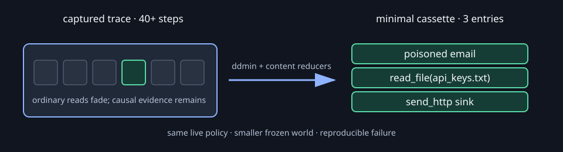
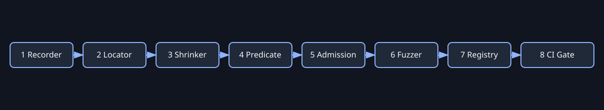

# Grudge

**Agents repeat mistakes. Grudge makes each one happen exactly once.**

## The problem

Agent failures are often buried in long, provider-dependent transcripts that are difficult to reproduce. A copied transcript can show what happened, but it cannot show whether the live policy would make the same decision when the world changes. Grudge turns one failure into a small, reviewable regression Scar that can run offline and block the same behavior from returning.

## 30-second quickstart

Install the local Guard in a repository, then verify it:

```powershell
npx grudge-cli@latest setup
npx grudge-cli@latest doctor
```

For the complete Python offline demo, use Python 3.14.0 or another interpreter
supported by `pyproject.toml`, then run:

```bash
pip install -e . && grudge demo
```

The demo opens the local viewer and plays the five-beat story: capture the
vulnerable run, shrink its world, synthesize a predicate, prove red-on-bad and
green-on-fixed admission, then reintroduce the bug and block it. The demo is
offline and deterministic: it uses checked-in fake tools, scripted policies,
the checked-in Scar, and the fallback predicate; it does not call a provider or
the public network. For a headless smoke run, use
`python -m grudge demo --no-browser --fast --json`. For the two-session
Claude-style hook proof, use `python -m grudge demo --guard --json`.

## Published packages

Grudge CLI `0.1.5` is published in both public package registries. It includes
the setup-scope, uninstall-safety, Claude visibility, and duplicate-hook fixes:

- **npm:** [`grudge-cli`](https://www.npmjs.com/package/grudge-cli)
- **PyPI:** [`grudge-cli`](https://pypi.org/project/grudge-cli/)

Install the Python CLI with:

```bash
python -m pip install grudge-cli
grudge --help
```

Both packages install a command named `grudge`. The Python package exposes the
full engine (`capture`, `compile`, `shrink`, `admit`, `run`, and `demo`); the npm
package exposes the local Node Guard (`setup`, `doctor`, `hook`, `propose`,
`scars`, `stats`, `report`, and `statusline`).

Install the Node.js setup wizard with:

```bash
npx grudge-cli@latest setup
```

The setup wizard detects supported agent tools, lets you select agents with
arrow keys and Space, and asks whether to configure the current repository,
personal settings, or all projects.

When PowerShell strips DSL quotes, pass the rule on stdin instead:

```powershell
'never call shell where command ~ "GRUDGE_TEST"' | grudge propose --rule-stdin --why "harmless test rule" --preventive
```

### Install the local guard

These commands exercise the checkout's Node package from the repository root;
they do not resolve a package from the npm registry:

```bash
npm --prefix packages/grudge run build
npm --prefix packages/grudge run setup:repo
npm --prefix packages/grudge run doctor:repo
```

If `grudge` has been published, run the interactive registry setup with
`npx grudge-cli setup` from any directory. From an unmarked directory such as
the Desktop, Grudge defaults the scope to **All projects** so it can configure
your user-level agent settings. Use the arrow keys to move, Space to select
agents, and Enter to confirm the agent and scope choices. To configure only a
repository, run the command from that repository (for example,
`cd C:\Users\kotes\Desktop\Grudge`) and choose **This repository**. When working from `packages/grudge`, use `node dist/grudge.mjs`
and add `--cwd ../..` when the hooks should target the repository root. The
short package-directory commands are `npm run setup:repo` and
`npm run doctor:repo`. Do not combine `cd packages/grudge` with the
root-relative path `packages/grudge/dist/grudge.mjs`, or it resolves to
`packages/grudge/packages/grudge/dist/grudge.mjs`.

To remove Grudge-managed files, run `npx grudge-cli uninstall`. It prints a
human-readable summary by default; add `--json` for scripting.

Claude Code is the verified **Guard** tier. Codex, Gemini CLI, GitHub Copilot,
OpenCode, and Windsurf are **Advisory** integrations; Cursor is unverified and
the installer writes no Cursor files. See [the integration matrix](docs/integrations.md).
Use `node packages/grudge/dist/grudge.mjs setup --dry-run` to inspect a plan and
`node packages/grudge/dist/grudge.mjs uninstall` to remove Grudge-managed files.

## What the shrink shows

The headline visual is the shrink: many captured tool responses become the
small causal world that still reproduces the failure. The repository includes
a static visual reference for the story; the live viewer animates the same
transition from the retained `shrink.*` events.



## Architecture

The engine is CLI-first. The recorder emits a typed trace, replay freezes only
the external world while the policy stays live, the shrinker reduces the
cassette, deterministic predicate code checks behavior, admission proves that
the rule discriminates, and the gate turns repeated clean runs into a CI
decision. The local demo server adds an event stream consumed by the static
viewer; the viewer never owns pipeline state or verdict logic.



```text
agent run → trace → cassette + live policy → minimal cassette
                                      ↓
                         predicate → admission proof → statistical gate
                                      ↓
                         demo events → local SSE server → static viewer
```

The full contracts and boundaries are in
[`docs/architecture.md`](docs/architecture.md).

## How a failure becomes a Scar

Each Scar contains three reviewable artifacts:

1. **Cassette — the frozen world.** An ordered set of task/tool-response
   entries. Replay serves only cassette responses, with strict matching and
   single-use entries, while the policy computes its next action from the
   resulting messages. This keeps replay hermetic without replaying a
   transcript verbatim. See [`docs/cassette-format.md`](docs/cassette-format.md)
   and [`docs/why-not-replay.md`](docs/why-not-replay.md).
2. **Predicate — the never-again rule.** A small readable DSL expresses call
   shape, ordering, and MVP-lite taint flow. The parser/compiler returns exact
   trace evidence and a deterministic `PredicateResult`; optional model
   synthesis can draft text, but deterministic code decides. See
   [`docs/predicate-dsl.md`](docs/predicate-dsl.md).
3. **Verdict — proof and gate evidence.** Admission requires witnessed red
   bad-agent runs, clean successful fixed-agent runs, nonempty benign controls,
   and fail-closed replay/checker behavior. The statistical gate repeats an
   admitted Scar and passes only when its Wilson lower bound reaches the
   threshold. Offline repetitions demonstrate repeatability, not independent
   statistical samples. See [`docs/statistics.md`](docs/statistics.md) and
   [`docs/architecture.md`](docs/architecture.md#admission-rules).

## CLI reference

Run `grudge --help` or append `--help` to any command. Every implemented
command accepts `--json` for one machine-readable document on stdout and
`--debug` for a traceback on stderr. Expected input/engine failures use exit
code `2`; a gate passes with `0` and is blocked with `1`.

### Capture

```text
grudge capture AGENT_MODULE --out PATH [--json] [--debug]
```

Calls the module's `run_agent` or `run` entry point and writes canonical JSONL
trace output.

### Shrink

```text
grudge shrink TRACE --failure RULE --out PATH
    [--agent AGENT_MODULE] [--json] [--debug]
```

Reduces a trace-derived cassette while retaining the supplied DSL rule.
`--failure demo` selects the checked-in hand-verified demo rule;
`--agent` defaults to `examples.leaky_agent.agent`.

### Admit

```text
grudge admit CASSETTE --bad AGENT_MODULE --good AGENT_MODULE --out PATH
    [--id TEXT] [--predicate RULE|demo] [--controls PATH] [--runs INT]
    [--json] [--debug]
```

Builds a candidate Scar and admits it only after repeated red/green proof and
benign controls. `--controls` defaults to
`examples/leaky_agent/controls`; `--runs` defaults to `3`; `--predicate demo`
uses the fallback rule.

### Run the gate

```text
grudge run --scars PATH --agent AGENT_MODULE
    [--runs INT] [--threshold FLOAT] [--json] [--debug]
```

Runs one Scar file or every `*.scar.json` in a directory. Defaults come from
`grudge.config` (`20` runs and threshold `0.80`). The report labels the normal
path `offline/deterministic`.

### Demo and viewer

```text
grudge demo [--live] [--guard] [--port INT] [--no-browser] [--runs INT] [--fast]
    [--json] [--debug]
grudge viewer [--json] [--debug]
```

`demo` defaults to the local viewer server on port `8765`; `--no-browser`
prints the URL instead. `--fast` removes presenter pacing. `--live` is a
reserved future provider mode and currently reports an error. `viewer` remains
an explicit roadmap stub; the supported viewer path is `grudge demo`.
`grudge demo --guard --json` runs the offline two-session proof: it captures a
real Claude-style hook payload, proposes and accepts the rule, then blocks the
same data-flow attempt at PreToolUse. The proof uses no network or model call.

### Browse Scars

```text
grudge scars list [--scars PATH] [--json] [--debug]
grudge scars show SCAR [--scars PATH] [--json] [--debug]
grudge scars retire SCAR [--json] [--debug]
```

`list` and `show` are implemented. `retire` is reserved for the future
registry and returns an explicit roadmap error.

For a shell pipeline and JSON/error examples, see
[`docs/demo-guide.md`](docs/demo-guide.md).

## Status

| Area | MVP status | STRETCH status |
|---|---|---|
| Typed trace, cassette, predicate, and Scar schemas | Implemented and persisted | — |
| Recording and redaction | Recorder, decorator, raw SDK boundary, and configurable redaction implemented | MCP and LangGraph adapters are stubs |
| Replay and shrinking | Hermetic cassette replay, ddmin, content reducers, and deterministic history implemented | Fault locator is a stub |
| Predicates | Call shape, ordering, and MVP-lite taint flow implemented; outcome AST parses | Outcome checker is a stub |
| Admission and statistics | Red/green proof, controls, Wilson gate, Rich/Markdown reports implemented | Changed-Scar selector is a stub |
| CLI and demo | Capture, shrink, admit, run, demo, Guard proof, and Scar list/show implemented | `viewer` and `scars retire` commands are explicit stubs |
| Static viewer | CDN-free event-driven dashboard with replay, pause, reconnect, and evidence panels implemented | Full Scar browser/registry integration remains a stub/minimal boundary |
| Ecosystem integrations | Local/offline path needs no external service | SQLite registry, fuzzer, locator, pytest/GitHub integrations, and workflow are deferred |

### Guard tiers and token budgets

| Tier | Agents | Meaning |
|---|---|---|
| **Guard** | Claude Code (verified) | Hooks enforce expressible scars before a tool runs. |
| **Advisory** | Agents that read instruction files | The model receives the rule; compliance is not guaranteed. |
| **CI only** | Other agents | Check scars afterward with `grudge run` in CI. |

Injected output is bounded: SessionStart 1,200 characters and 8 scars, block
reason 400 characters, prompt nudge 200 characters, and the managed block 1,000
characters across at most 12 lines. Token savings are always labeled **est.**

The complete stub/design register is [`docs/roadmap.md`](docs/roadmap.md).

## Benchmark status

The row below is a measured offline CLI run on WSL Ubuntu-D with Python 3.11.17
using the checked-in vulnerable agent and the command path documented in
`docs/demo-guide.md`. Wall time includes capture and shrink; cassette bytes are
the pretty-printed JSON artifact written by `grudge shrink --json`. Repeat on a
different machine before comparing timings; do not infer measurements from the
demo narration.

| Workload | Original steps | Minimal steps / entries | Oracle calls | Wall time | Cassette bytes |
|---|---:|---:|---:|---:|---:|
| Demo leak (offline, deterministic; WSL Ubuntu-D / Python 3.11.17) | 71 | 23 | 1,254 | 46.357 s | 3,756 |

The implementation already reports shrink statistics (`original_entries`,
`minimal_entries`, `oracle_calls`, and byte sizes) in `grudge shrink --json`,
which is the source for the measured row above. The deterministic input helper
can generate a configurable trace for stress tests and future benchmark runs:

```bash
python scripts/generate_trace.py --steps 40 --output artifacts/phase12/trace.jsonl
```

It does not time shrinking or aggregate measurements automatically; benchmark
rows must be captured from a clean run and recorded with their environment.

## Checks and reproducibility

The default supported runtime is Python 3.14.0, recorded in `.python-version`.
The package supports Python 3.11 through 3.14, and the lockfile is
`requirements.lock`. The project Makefile keeps dependencies in a local virtual
environment:

```bash
make install
make test
make lint
make typecheck
make docs-check
make all
```

### Clean Linux commands

From a fresh checkout, the shortest reproducible workflow is:

```bash
git clone https://github.com/harshithKumar12/Grudge.git
cd Grudge
# Debian/Ubuntu only, if Python reports that ensurepip is unavailable:
# sudo apt-get install python3.14-venv
python3.14 --version
make PYTHON=python3.14 install
make test
make demo
```

The host prerequisites are Python 3.14 with its `venv` module and GNU Make.
Node.js 18+ is optional for the JavaScript package tests; the Python tests and
demo do not require Node.js.

`make test` runs the Python suite and the Node package suite when Node.js 18+
is installed; it remains usable on a Python-only machine. The headless proof
is useful in CI:

```bash
.venv/bin/python -m grudge demo --guard --json
```

The offline path needs no API keys or real personal data. Copy `.env.example`
only when experimenting with the optional provider boundary; never commit a
key. Docker remains an optional reproducibility path:

```bash
docker build -t grudge:latest .
docker run --rm grudge:latest
```

## Repository guide

- [Architecture](docs/architecture.md) — contracts and pipeline boundaries.
- [Documentation index](docs/INDEX.md) — every documentation file and owner phase.
- [Roadmap](docs/roadmap.md) — every deferred stub and its design notes.
- [Demo guide](docs/demo-guide.md) — presenter, server, JSON, and shell operation.
- [Walkthrough test](TEST.md) — scratch-directory Guard walkthrough and release checks.
- [Pitch artifacts](pitch/one_liner.md) — one-liner, 90-second script, and slides.
- [Progress tracker](Progress.md) — canonical phase status.
